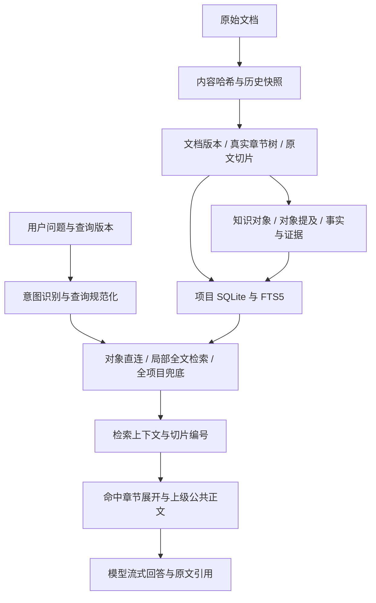

# 技术架构与项目亮点

更新日期：2026-11-11  
适用范围：当前工作区实现，内容索引版本 V7。

本文用于项目介绍、技术交流和交接，重点说明已落地的架构及文档版本管理设计。实现依据为当前源码和专题文档；本次整理未重新运行测试，不代表生产验收结论。具体操作见 [文档版本管理](DOCUMENT_VERSIONS.md)，历史架构决策见 [ARCHITECTURE_V2.md](ARCHITECTURE_V2.md)。

## 1. 项目定位

本项目是面向本地规则、接口和业务文档的可追溯知识问答平台。系统将原始文档组织为带版本的章节、切片、知识对象和事实证据，通过对象优先检索定位原文，再由模型基于证据生成带引用的回答。

项目的核心价值是：保留知识来源和文档结构，明确本次问答使用的版本，支持从结论追溯到具体版本的原文证据，并在文档更新、摄入失败和索引重建时维护这些关联。

## 2. 总体技术架构

### 2.1 分层与职责

| 层次 | 技术与模块 | 主要职责 |
| --- | --- | --- |
| 交互层 | Vue 3、Vite | 问答、证据查看、查询版本选择、摄入、版本管理和评测管理 |
| 接口与业务层 | Django、会话认证、管理员权限 | 项目管理、任务调度、检索编排、回答生成和运维接口 |
| 控制面数据层 | Django ORM 管理的业务数据库 | Project、来源目录、IngestionJob、评测记录和操作审计 |
| 项目内容层 | 每项目独立 SQLite、FTS5 | 文档版本、章节树、检索切片、知识对象、事实关系和证据 |
| 摄入处理层 | 多格式转换、结构解析、模型抽取 | 文件转换、切片、对象与关系抽取、缓存和断点恢复 |
| 模型接入层 | OpenAI 兼容接口、SSE 流式响应 | 意图识别、知识抽取、回答和辅助评分 |

控制面负责管理项目与任务，项目内容库负责保存可查询的知识和证据。每个项目有自己的 `.index/search.db`，便于独立维护、迁移和排查。

### 2.2 核心数据链路

Markdown 用于文档转换留档和只读导出。运行时搜索、回答和图谱以结构化内容库为依据，不依赖重新读取导出的 Wiki 页面。

## 3. 文档结构与可追溯证据

内容模型保留从知识到原文的定位关系：

| 数据对象 | 作用 |
| --- | --- |
| DocumentVersion | 保存解析内容及其内容哈希、解析器版本 |
| StructuralNode | 保存章节树、父子关系、标题路径及原文位置 |
| RetrievalChunk（对应 `chunks` 表） | 保存用于检索的原文切片及所属版本、章节 |
| KnowledgeObject / ObjectTerm | 保存知识对象身份、规范名和检索词项 |
| ObjectMention | 将对象在原文中的出现关联到版本、章节和切片 |
| Claim / ClaimEvidence | 保存抽取的事实关系及其原文依据 |

DOCX 按标题样式和大纲建立真实章节树，保留段落、列表和表格文本语义；检索切片不跨章节。回答时将命中切片展开为对应最深章节，并补充祖先章节公共正文，帮助保留条款的前提、限制和例外。

知识抽取用于组织与定位信息，回答仍需基于原文证据。该设计为引用核查提供了明确路径，但最终抽取与回答质量仍需要业务样本评测。

## 4. 文档版本管理设计

### 4.1 区分逻辑文档、业务版本和解析版本

系统用 `document_editions` 维护业务版本归属：`logical_id` 表示逻辑文档，`uid` 标识具体业务版本，`label` 保存人工版本号。每个业务版本对应独立的 `documents` 记录，沿用既有切片和证据外键。

底层 `document_versions` 记录解析内容，并以文档、内容哈希和解析器版本组合区分解析记录。业务版本与解析记录分开表达，避免将“2026 版”这样的业务标签与解析器变化混为一谈。

例如，“上市规则”可以包含“2025”“2026”两个业务版本，每版拥有自己的原文快照、章节、切片和知识证据。不同文件名的版本通过人工指定“所属文档”关联，不依赖文件名猜测年份或自动合并。

### 4.2 持久快照与重复导入处理

- `document-history/` 保存按 SHA-256 内容哈希命名的原始文件快照，并通过 `catalog.json` 保存版本目录。
- 同来源、相同内容重复导入不会新增版本；同路径内容变化会新增修订。
- 新修订保留旧版原文、切片和证据；原始来源被覆盖或删除不会自动删除历史版本。
- 版本标签、文档归属及默认状态可以维护，修改这些元数据无需重新调用模型。

内容哈希同时用于快照校验和内容变化识别。历史目录应与索引、业务数据库一起纳入备份，不能将其视为可随意删除的缓存。

### 4.3 显式管理默认版本

每份逻辑文档维护自己的默认版本，新增修订不会自动切换默认版。管理员确认新版可用后再切换，查询用户也可以临时选择历史版。

数据库通过唯一约束防止同一文档出现重复版本标签，通过部分唯一索引限制每份文档最多一个默认版。业务逻辑负责维护默认状态，并拒绝将无切片的空版本设为默认版。

发布日期、生效日期目前属于版本元数据，不代表已经实现按日期自动选择版本。

### 4.4 版本范围贯穿检索与回答

请求中的 `versionScope` 使用“逻辑文档 ID → 版本 ID”指定查询范围。每份文档在一次查询中选用一个版本，未指定的文档采用各自默认版。

底层 `apply_version_scope` 通过连接级临时表和临时视图统一限制可见数据，范围覆盖：

- 文档、解析版本、章节和原文切片。
- 对象来源、对象提及、描述、别名与关键词。
- Claim 及其证据、全文检索、知识图谱。
- 章节展开、回答上下文和最终引用。

FTS 在候选数量截断前进行版本过滤，避免未选中的历史版挤占有效候选。项目同义词可辅助扩展查询，但不作为事实证据。

### 4.5 对象身份共享，知识描述按版本来源隔离

不同版本可以描述同一个知识对象，因此对象身份可共享；对象描述、别名和关键词通过 `object_version_profiles` 按来源版本保存。查询只组合所选版本贡献的信息，Claim 也必须在当前版本范围内具有证据才可见。

这一设计处理了版本管理中的隐蔽问题：即使原文切片过滤正确，共享对象摘要仍可能将新版事实带入旧版回答。对缺乏来源的旧共享描述，系统采取保守策略，不将其直接用于版本回答。

### 4.6 防止旧搜索上下文被误用

前端切换版本会清空旧搜索结果、回答和搜索上下文。后端同时校验 `searchContextId` 所属用户、项目、问题和版本范围；相关默认版本变化时，拒绝继续复用旧上下文并要求重新检索。

版本范围之外的切片和文档也会受到服务端校验，避免仅依赖页面状态控制证据边界。

### 4.7 私有索引处理与受控发布

摄入先在私有 SQLite 索引中解析、抽取和验证，再发布到线上内容库。发布前检查原文哈希、索引完整性及线上索引基线；原文或索引在处理中变化时拒绝发布，要求重试。

摄入支持按文档判断完整性，完整文档可作为成功部分发布，失败文档不会以不完整的新证据进入检索；全部失败时不发布空索引。未参与本次导入的文档和历史版本保留。具体失败处理与普通索引重建的规则见 [摄入容错说明](INGESTION_RESILIENCE.md)。

### 4.8 迁移与恢复

首次版本迁移前保存索引备份，尽量保留既有切片编号和证据关联。原文件已被覆盖或缺失时，将索引内文本保存为“迁移版本（仅文本）”，明确其不能恢复原始 Word/PDF 排版和附件。

历史快照及版本目录支持重建原文索引，并保留版本标签和默认设置。删除内容索引后，抽取知识仍需要重新摄入。早期记录缺少历史切片时，界面会提示其无法作为完整历史查询。

## 5. 检索与回答亮点

### 5.1 对象优先、分层兜底

检索依次尝试完整对象及别名、对象关联原文、关联原文局部 FTS、全项目 FTS。证据充分时可以跳过全项目检索，不强制凑满 Top K，有助于减少上下文噪声和无效处理。

这一方式适合规则名称、接口名、字段名及业务术语等精确查询。中文查询结合 jieba、项目对象词典与意图识别；完整短语与标识符受保护，FTS 候选还需验证连续短语实际命中，减少碎片词误召回。

### 5.2 搜索与生成复用同一证据链

`/search` 返回 `searchContextId`、查询计划和 `chunkId`。回答复用仍有效的意图与证据选择，从内容库读取正文并展开章节，减少重复分析及检索、回答之间的证据偏移。

上下文中携带文档名与版本标签，回答通过引用编号关联原文证据，便于人工核查。

## 6. 摄入、评测与运维能力

| 能力 | 已实现设计 | 价值 |
| --- | --- | --- |
| 多来源摄入 | 本机文件／目录上传、服务端目录、按文档重新摄入 | 适应本地及内网使用方式 |
| 解析效率 | 受控并行转换、按内容及解析器版本缓存 | 减少健康文件重复解析 |
| 抽取恢复 | 块级断点、超时、重试、批量失败拆单 | 降低长任务失败后的重复成本 |
| 提示词管理 | 校验、任务快照、指纹进入断点键 | 避免不同提示词的抽取结果混用 |
| 可诊断性 | 逐文档状态、任务日志、转换产物与检查器 | 支持定位解析、抽取和证据关联问题 |
| 问答评测 | 标准问答导入、后台评分、答案对照、人工复核和报告 | 支持建立可重复的质量基线 |
| 评测留档 | 保存题目、实际证据、模型配置与代码／索引指纹 | 为结果追溯和变更分析提供依据 |
| 权限与审计 | 会话认证、管理员操作控制、操作审计与留存维护 | 支持内网管理与问题调查 |

评测索引指纹属于保守变化检测，不等同于内容级版本仓库；自动评分也需要业务专家校准。系统采用本地持久化和 OpenAI 兼容模型接口，适合内网部署，是否完全离线取决于所配置的模型服务及运行依赖。

## 7. 能力边界与后续方向

| 项目 | 当前状态 |
| --- | --- |
| 手动版本标签、文档归属、默认版与历史版查询 | 已实现 |
| 原文快照、证据版本隔离、私有索引处理与发布校验 | 已实现 |
| 自动业务版本识别、按日期自动选版、版本差异比较 | 尚未实现 |
| 向量召回 | 尚未实施，是否引入需依据真实问题集评测 |
| 多轮会话记忆 | 尚未实现，搜索上下文仅服务于短期检索复用 |
| 确定性统计问答 | 尚无独立链路，不能用 Top K 条数替代业务计数 |
| 抽取与回答质量基线 | 已有评测工具，仍需真实问题集和业务验收 |
| 未引用历史快照自动清理 | 当前不提供 |

源码中的版本专项测试覆盖默认／历史冲突、别名与描述来源隔离、Claim、回答与章节隔离、失效上下文、发布冲突、迁移和恢复等场景。测试覆盖的存在不等同于本次已执行或生产环境已通过验收。

## 8. 代码与专题文档索引

| 入口 | 内容 |
| --- | --- |
| [backend/api/models.py](backend/api/models.py) | 项目、任务和评测等管理数据模型 |
| [backend/api/document_versions.py](backend/api/document_versions.py) | 版本目录、历史快照、迁移、默认版和查询范围 |
| [backend/api/search_index.py](backend/api/search_index.py) | 内容模型、FTS、摄入发布和章节证据 |
| [backend/api/ingestion_staging.py](backend/api/ingestion_staging.py) | 转换留档、私有索引和文档级处理 |
| [backend/api/views.py](backend/api/views.py) | 检索上下文、问答接口和任务编排 |
| [backend/api/tests/test_document_versions.py](backend/api/tests/test_document_versions.py) | 版本管理专项测试 |
| [DOCUMENT_VERSIONS.md](DOCUMENT_VERSIONS.md) | 文档版本操作、迁移和限制 |
| [INGESTION_RESILIENCE.md](INGESTION_RESILIENCE.md) | 摄入容错、断点和提示词管理 |
| [EVALUATION.md](EVALUATION.md) | 问答评测与人工复核 |
| [AUDIT_RETENTION.md](AUDIT_RETENTION.md) | 操作审计和日志留存 |
